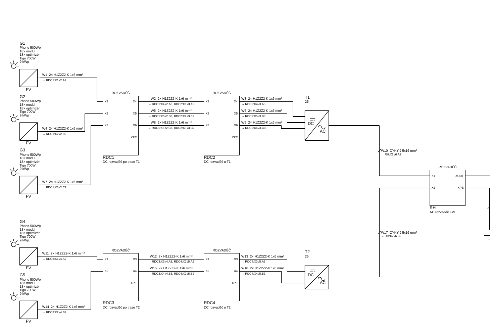
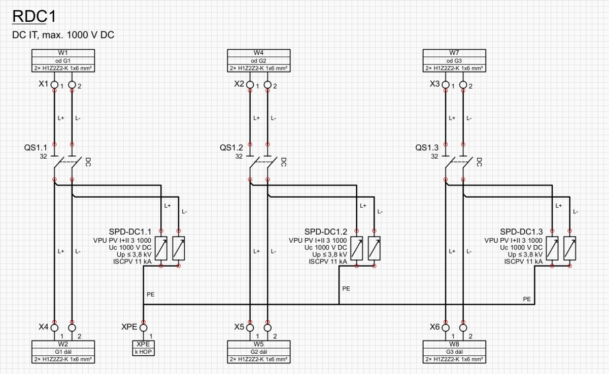

# EnvoCAD

Open-source CAD pro elektro dokumentaci fotovoltaických elektráren – jednopólová schémata, rozvaděče
(vícepól, rozložení, oteplení), výkazy a technická zpráva z jednoho datového modelu. Vzniká v ENVO s.r.o.
jako náhrada EPLAN pro FVE: data-driven – projekt se dá vygenerovat ze specifikace (stringy, střídače, rozvaděče)
a rozvaděče se skládají z maker, která si projektant vyladí sám.





## Stažení

```
git clone https://github.com/papro-thc/EnvoCAD.git
cd EnvoCAD
```

## Instalace (Windows i Linux)

Doporučený Python 3.11–3.13 (3.14 je nový a PySide6 na něm není prověřené).

```
# Windows (PowerShell)
powershell -ExecutionPolicy Bypass -File scripts\install.ps1
scripts\run.ps1

# Linux (Fedora/Ubuntu)
bash scripts/install.sh
scripts/run.sh            # Wayland potíže: QT_QPA_PLATFORM=xcb scripts/run.sh
```

Ručně: `python -m venv .venv`, aktivovat, `pip install -e .[dev]`, `python -m envocad`.

## Samostatná aplikace (bez Pythonu, pro kolegy)

`scripts\build.ps1` (Windows) / `scripts/build.sh` (Linux) sestaví přes PyInstaller složku `dist/EnvoCAD`
s binárkou `EnvoCAD.exe` / `EnvoCAD` (~260 MB, obsahuje Qt). Složku zabalte do ZIP a rozdejte; data
uživatele (knihovna, pluginy, logy) jsou v `~/.envocad/`, takže aktualizace = přepsat složku aplikace.
Build pro Windows se musí dělat na Windows, pro Linux na Linuxu.

## Stav

**v0.11** (viz `CHANGELOG.md`):

- **JPS FVE** – stringy s počtem modulů a optimizérů, DC rozvaděče po trase a u technologie, střídače
  (DC vstup na každý string), AC rozvaděč, uzemnění na HOP; křížové odkazy JPS ↔ rozvaděče.
- **Generátor projektu** – průvodce nebo JSON specifikace → celý projekt; rozvaděče z parametrických maker
  (`{k}`, `{string}`, `{fuse_in}`…), vlastní makro přepíše vestavěné.
- **Rozvaděče** – vícepólové schéma jako v EPLAN (sběrnice potenciálů, svorky s můstky, více stran s odkazy,
  kreslení přímo ve vícepólu), fyzické rozložení na DIN lištách, parametry skříně a odhad oteplení.
- **Kreslení** – vodiče jen svisle/vodorovně, lomy jdou s prvky, úsek vodiče se dá táhnout myší, souběžné
  vodiče drží odstup; popisky prvků a kabelů se rozmístí bez překryvů.
- **Kontroly (F7)** – duplicitní označení, potenciály a zkraty, výpočty (stringy, Iz, úbytky, selektivita),
  překryvy textů a souběhy vodičů, se skokem do výkresu.
- **Výstupy** – výkazy xlsx (BOM, kabely, svorky, potenciály…), protokol kusového ověření a TZ (docx),
  PDF celé dokumentace, DXF pro ZWCAD/AutoCAD.
- **Knihovna** – ~460 artiklů (OEZ, Eaton, Schneider, Hager, SMA, SolaX, Huawei, BMR…), 673 značek QElectroTech,
  import DXF/EPLAN, sdílená firemní knihovna, pluginy.
- **Rozhraní** – lišty s ikonami, které se mění podle pohledu (Kreslení v JPS a schématu rozvaděče, Dispozice
  v rozložení), hledání příkazů `Ctrl+K`, menu na pravém tlačítku, kontrola F7 jako panel pod výkresem, stavový
  řádek se souřadnicemi, zoomem a počtem chyb, úvodní obrazovka, režim Jen výkres (`F11`), tmavý režim; okno si
  pamatuje velikost a rozložení panelů.

Dokumentace: **`docs/MANUAL.md` (uživatelská příručka)**, `docs/ARCHITECTURE.md`, `docs/LIBRARY_FORMAT.md`,
`docs/ROADMAP.md`, `docs/COMPONENTS.md`, `docs/ENVO_STYL.md` (konvence výkresů ENVO).
Nastavení a firemní standard: `~/.envocad/settings.json` (menu Knihovna), sdílená knihovna = síťová složka s JSON/CSV.
Pokyny pro AI agenty: `CLAUDE.md`, `docs/AGENTS.md`.

## Ovládání editoru

| Akce | Jak |
|---|---|
| Lišty | Soubor, Úpravy, Pohled, Kreslení, Dispozice, Kontrola a výstupy; tooltip ukáže název a zkratku. Kreslení je jen v JPS a schématu rozvaděče, v rozložení je místo ní Dispozice. Lišty i panely jdou přetáhnout, `Zobrazit → Obnovit rozložení panelů a lišt` vrátí výchozí stav |
| Hledat příkaz | `Ctrl+K` – napište část názvu (i bez diakritiky), Enter spustí |
| Pravé tlačítko | ve výkresu nabídne Vlastnosti, Otočit, Kopírovat, Smazat, u vodiče Svorky/Kabel/Narovnat, u bloku ROZVADĚČ Otevřít rozvaděč; v režimu Vodič/Vkládání jen ukončí režim |
| Jen výkres | `F11` schová všechny panely, druhým stiskem se vrátí |
| Stavový řádek | vpravo souřadnice kurzoru v mm, mřížka, zoom, souhrn kontroly F7 (klik otevře panel Kontrola), „● neuloženo“ |
| Vložit symbol | dvojklik v panelu Knihovna, nebo značku v Knihovně označit a tlačítko Vložit značku; klik do výkresu, vyplnit parametry v dialogu (Esc zruší režim) |
| Upravit parametry | dvojklik na prvek nebo vodič |
| Posun | tažení myší (snap na mřížku 2,5 mm); ruční lomy vodičů jdou s prvky |
| Úprava trasy vodiče | chytit úsek vodiče a táhnout (vodorovný nahoru/dolů, svislý do stran); `N` narovná vybrané vodiče |
| Značení | žíly dle ČSN EN 60445 (L1 L2 L3 N PE, DC L+ / L−); výkaz Značení vodičů a kabelů (ČSN EN 62491): štítky kabelů W s adresou protějšího konce a návlečky vodičů rozvaděče – adresné / odkud-kam / číslo (Výrobní data skříně) |
| Svorky střídače | střídač s artiklem (Huawei, SolaX, GoodWe, Growatt, Sigenergy, SolarEdge) má pod značkou pás svorek BACKUP / BMS / METER / RS485 / LAN / DI…; atribut Svorky střídače (`io`) je přepíše |
| Rotace / zrcadlení | `R` (o 90°), `M` zrcadlí podle svislé osy značky (i během vkládání) |
| Text | `T`, klik do výkresu, text a výška písma; dvojklik upraví, `Delete` smaže |
| Vodič | `W`, klik na port → klik na port, vyplnit parametry (označení, kabel, průřez) |
| Smazat | `Delete` |
| Zoom / posun pohledu | kolečko / střední tlačítko; `Ctrl++` / `Ctrl+-` přiblížit / oddálit, `Home` přizpůsobit list |
| Undo / redo | `Ctrl+Z` / `Ctrl+Y` |
| Tmavý / světlý režim | `Ctrl+D` |
| Otevřít rozvaděč | dvojklik na blok ROZVADĚČ (poprvé nabídne šablonu) – otevře vícepólové schéma; `Ctrl+J` přepne na jednopólovou editaci (vkládání, vodiče) |
| Rozložení rozvaděče | `Ctrl+L` na listu rozvaděče; přístroje přetáhnout na DIN lišty; parametry skříně a oteplení v panelu vpravo (`Ctrl+Alt+K`) |
| Výkazy / protokol | menu Výstupy (xlsx, docx) |
| Přečíslovat | Úpravy → Přečíslovat označení: doplní chybějící a opraví duplicitní označení, nebo přečísluje vše podle polohy (aktuální list / projekt, přístroje i vodiče, náhled, jeden krok undo) |
| Vícepól | `Ctrl+M` otevře vícepólový pohled listu (odvozený z JPS, `Ctrl+J` zpět); žíly vodiče se zadávají v dialogu vodiče („Žíly“), dvojklik na žílu / `Ctrl+T` = svorky, Úpravy → Očíslovat svorky |
| Svorkovnice a můstky | `Ctrl+Shift+T` – tabulka svorek vybrané svorkovnice, můstky jako „1-6-11“ (jedna skupina na řádek); skupina svorek v JPS = prvek Svorky s čísly v atributu „terminal“ |
| Plán svorkovnice | `Ctrl+Shift+M` – kreslený plán svorkovnice (export PDF), totéž jako list ve výkazech |
| Kopírovat / vložit | `Ctrl+C` / `Ctrl+V` – prvky i vodiče mezi nimi, nová označení |
| Sběrnice potenciálů | rozvod vodičem jako v EPLAN: čáry L1…PE přes stranu, názvy `1L1` na koncích, odbočky tečkou; nebo svorky s můstky |
| Rozvaděč na více stran | vícepól se stránkuje sám, přerušovací body s odkazy `/3.2.B4`, PDF po stranách |
| T-odbočka | v režimu Vodič klik na vodič → uzel, odbočka z něj (vodič z vodiče) |
| Potenciály | sítě přes vodiče, uzly, svorky, můstky, přívody; kontrola zkratů v F7, potenciál žíly ve Vlastnostech, výkaz Potenciály |
| Makra | `Ctrl+Alt+M` uloží výběr jako makro, uzel Makra v knihovně – dvojklik vloží |
| Vazba na JPS | u přívodu/vývodu rozvaděče v dialogu „Vodič v JPS“ – přebere kabel a žíly, křížový odkaz u vodiče |
| Kontrola / navigace | `F7` otevře panel Kontrola pod výkresem (filtr závažnosti, dvojklik na nález skočí do výkresu, po změnách se obnoví sám), `Ctrl+F` najít označení, dok Navigátor |
| Kabely | `Ctrl+Shift+K` kabel vybraného vodiče: žíly, čísla, barvy, stínění, artikl; výkazy Kabelový plán, Zapojovací seznam a Kabely a vodiče k objednání (metry podle typu, vodiče rozvaděče, dutinky) |
| Dokumentace | `Ctrl+Shift+E` celá dokumentace do jednoho PDF (titulní list, obsah, listy, výkazy, změnový list) |
| Ovládací obvody | značky Cívka / Kontakt NO / NC / silový (Relé a stykače); kontakt dostane označení cívky, pod cívkou se kreslí zrcadlo kontaktů |
| Výpočty | `F7` ukáže i výpočty (stringy, Iz, In ≤ Iz, úbytky, selektivita); výkaz Výpočty; uložení kabelu v atributu „Uložení dle ČSN“ nebo v textu trasy (zem, vzduch, trubka, stěna) |
| Nový projekt | `Ctrl+Shift+N` průvodce (stringy, střídače, DC rozvaděče po trase a u technologie, kabely) nebo `Soubor → ze specifikace (JSON)`; CLI `python -m envocad.generate spec.json out.ecp` |
| Revize | `Soubor → Porovnat s revizí` → změnový list; `Soubor → Vlastnosti` revize/datum |
| Připomínky | `Ctrl+Shift+P` připomínka (klik = bod, tah = oblast); Navigátor → Připomínky (filtr, dvojklik = skok); Zobrazit → Připomínky; Výstupy → Přidávat připomínky do exportu (anotace PDF, vrstva `PRIPOMINKY` v DXF); podrobnosti `docs/MANUAL.md` sekce 9 |
| TZ / DS | `Výstupy → Technická zpráva (docx)`, výkaz Data pro DS |
| Artikl z knihovny | v dialogu prvku „Vybrat artikl z knihovny…“; menu Knihovna → Prohlížet / Importovat CSV |

## Vývoj

```
pip install -e .[dev]
pytest                                            # headless testy
QT_QPA_PLATFORM=offscreen pytest tests/test_gui_smoke.py
ruff check .
```

Model (`envocad/model`, `envocad/library`) je bez Qt a testuje se headless; GUI je PySide6 (`envocad/ui`).
Chyby a nápady: [Issues](https://github.com/papro-thc/EnvoCAD/issues).

## Když program spadne

Log každého běhu je v `~/.envocad/log/envocad.log` (Windows: `C:\Users\<jméno>\.envocad\log\`),
předchozí běhy `envocad.log.1` … `.5`. Otevře ho menu Nápověda → Otevřít složku s logy.
Neošetřená chyba se zapíše do logu a zobrazí v dialogu; program většinou běží dál – uložte práci.

## Licence

Kód EnvoCAD je pod licencí **MIT** (viz `LICENSE`). Součástí repozitáře jsou i data třetích stran:

- ikony lišt v `envocad/resources/icons/` jsou z [Lucide](https://lucide.dev) 0.460, licence **ISC**
  (`LICENSE-lucide.txt`); elektro ikony (vodič, vícepól, DIN lišta, svorkovnice…) jsou vlastní ve stejném stylu;

- značky `envocad/library/builtin/qet/` jsou převedené z kolekce QElectroTech, **CC BY 3.0**, autorství viz
  `envocad/library/builtin/qet/ATTRIBUTION.md`;
- artikly v `envocad/library/builtin/components/*.csv` jsou technické parametry opsané z veřejných katalogů
  výrobců (OEZ, Eaton, Schneider, Hager, Weidmüller, Elektro Bečov, ELEMAN, SMA, SolaX, Huawei, BMR) – u každého
  řádku je zdroj a strana; katalogy samotné v repozitáři nejsou. Hodnoty jsou bez záruky, před použitím v projektu
  je ověřte u výrobce;
- tabulky v `envocad/model/thermal.py` a `envocad/model/calc.py` (IEC TR 60890, ČSN 33 2000-5-52) jsou orientační
  přepisy, ne text norem.

Název firmy v popisovém poli se nastavuje v `~/.envocad/settings.json` (`standard.company`), výchozí je ENVO s.r.o.
